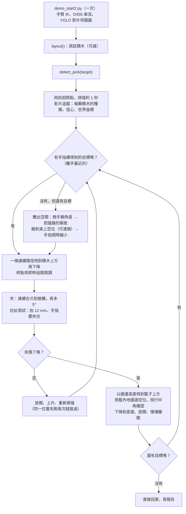

# arm-detect-and-pick

> English version: [README.md](README.md)

## 目的

在 Isaac Sim 裡，讓 NHC12 手臂（手腕裝 Robotiq 2F-85 夾爪和 D455 相機）自己找出桌上指定種類的積木，並依序夾進籃子，**步驟之間不停頓**。

- 積木有四種：`cube`、`cuboid`、`cylinder`、`sphere`（20–60 mm）。
- 手臂看到的一切都來自手腕 D455 的串流：YOLO 的類別與遮罩、深度都是連續運算，每顆積木的世界座標在手臂移動時也持續更新。
- 手臂每一段走一條連續路徑，只有夾取和放開時才停。
- 籃子也用同一支深度影片讀取：只放在空位，絕不放在已有積木的上面。
- 如果所有目標都被鄰居擋住，手臂會先把鄰居移開。

<p align="center"></p>

### 示範

下面三支是手腕相機的錄影（左上角即時列出每顆積木的種類、信心和世界座標）。每次都是一次呼叫，例如 `detect_pick("sphere")`。

<table>
  <tr>
    <th align="center">cylinder</th>
    <th align="center">sphere</th>
    <th align="center">cube</th>
  </tr>
  <tr>
    <td align="center"><br><a href="media/demo_cylinder.mp4">mp4</a></td>
    <td align="center"><br><a href="media/demo_sphere.mp4">mp4</a></td>
    <td align="center"><br><a href="media/demo_cube.mp4">mp4</a></td>
  </tr>
  <tr>
    <td valign="top">
      <table>
        <tr><th>pick</th><th>conf</th><th>到位→放開 (秒)</th></tr>
        <tr><td>1</td><td>0.97</td><td>3.15</td></tr>
        <tr><td>2</td><td>0.96</td><td>4.03</td></tr>
      </table>
    </td>
    <td valign="top">
      <table>
        <tr><th>pick</th><th>conf</th><th>到位→放開 (秒)</th></tr>
        <tr><td>1</td><td>0.85</td><td>3.40</td></tr>
        <tr><td>2</td><td>0.90</td><td>3.17</td></tr>
        <tr><td>3</td><td>0.86</td><td>3.80</td></tr>
      </table>
    </td>
    <td valign="top">
      <table>
        <tr><th>pick</th><th>conf</th><th>到位→放開 (秒)</th></tr>
        <tr><td>1</td><td>0.51</td><td>3.67</td></tr>
        <tr><td>2</td><td>0.93</td><td>3.38</td></tr>
      </table>
    </td>
  </tr>
</table>

*conf* ＝選定這顆積木時的 YOLO 信心。*到位→放開* ＝從手到達積木位置，到積木在籃子裡放開的時間（模擬秒）。

## 使用的設備

| 項目 | 內容 |
|---|---|
| 模擬器 | NVIDIA Isaac Sim 6.0.0（場景 `scenes/arm310d_d455_ik_demo.usd`） |
| 手臂 | Yaskawa Motoman NEXT NHC12，以差分 IK 追隨目標 prim（`/World/IKTarget`） |
| 夾爪 | Robotiq 2F-85（最大開口 85 mm，每指 31 × 27 mm） |
| 相機 | 手腕上的 Intel RealSense D455：RGB + 深度，640 × 480，path tracing |
| 辨識 | YOLO26n-seg（`models/best.pt`，四個類別），在獨立 Python 環境（`perception/.venv`）執行；深度 → 世界座標 |
| 場景 | 包裝桌、籃子 `container_h20`（底部是格網）、有物理的測試積木（摩擦 1.0；球和圓柱加阻尼） |

YOLO 用 328 張模擬影像訓練（20 顆積木，每類 5 顆；相機高 0.43–0.56 m、傾角 9–27°；100 epochs；mask mAP50 0.885）。細節：`models/train_args.yaml`、`models/train_results.csv`。

## 產出儲存位置

所有報告、影片、圖片、日誌一律寫入 `outputs/`，這是指向 `/mnt/data/Lin(sda)/nhc-d455-yolo-2(result only)` 的符號連結。執行前保持 `/mnt/data` 掛載。Git 只記錄連結，不記錄檔案。示範影片和總覽圖放在 `media/`。

## 使用方法

**第一次（只做一次）**：建立 YOLO 用的 Python 環境（不動 Isaac Sim 內建的 python）。

```bash
bash perception/setup_yolo_env.sh
```

**每次開 Isaac Sim 後**

1. 開啟本資料夾的 `scenes/arm310d_d455_ik_demo.usd`（不用先按 Play）。
2. Script Editor 開 `demo_start2.py` → Ctrl+Enter **一次**。它只讓手臂準備好（約 10 秒），印出 `demo_start2: READY`。不會移動。
3. 在 Script Editor 呼叫函數：

```python
layout("sphere")          # （測試用）新擺 10 顆積木，包含該類型所有尺寸；籃子清空
detect_pick("sphere")     # 把所有 sphere 夾進籃子
```

**函數**

| 呼叫 | 做什麼 | 結果 |
|---|---|---|
| `detect_pick(target)` | `target` ＝ `"cube"`（預設）/ `"cuboid"` / `"cylinder"` / `"sphere"`。先看桌面約 1 秒，然後把該類型的積木依序夾進籃子。`max_picks`（預設 12）限制夾取次數 | `outputs/lab/live/run_<時間>/index.html` |
| `layout()` | （測試用）隨機擺 10 顆任意種類積木，有物理；籃子清空；原場景的紅色 `object` 方塊在這次執行中移除（不存檔） | 印出各類型數量 |
| `layout("sphere")` | 同上，但保證該類型的每種尺寸都在桌上（sphere 40/50/60 mm），讓 `detect_pick("sphere")` 有東西可夾 | — |

- 兩個函數都立刻返回，動作在背景執行；console 先印 `started`，結束時印 `done`（附簡短結果）。同時只能執行一個動作；忙碌時再呼叫會印 `[busy]`。
- 同一個擺放可以連續對不同類型呼叫 `detect_pick()`。籃子內容會跨次記住；`layout()` 會重設。
- 動作進行中 IK 目標標記會隱藏（否則會擋住相機）。
- Script Editor 不會重新載入磁碟上改過的檔案。`lab/*.py` 每次 `detect_pick()` 都從磁碟讀取，但 `layout()` 在 `lab/api2.py`，由 `demo_start2.py` 載入：改了 `api2.py` 之後，要對 `demo_start2.py` 再按一次 Ctrl+Enter。
- 時間：每顆約 5–6 秒，加上掃描和回家約 1.5 秒。

**每次執行寫出的東西**（`outputs/lab/live/run_<時間>/`）

| 檔案 | 內容 |
|---|---|
| `index.html` | 影片、每次夾取一列（種類、信心、秒數）、哪些積木被移動 |
| `wrist.mp4` | 標註過的手腕影片；左上角清單 `#id 種類 conf x y z d` 每一張畫面更新 |
| `result.json` | 所有數字：事件（模擬秒）、夾取資料、拉扯測試、籃內放置點、追蹤結果與場景真值對照 |
| `frames/` | 單張標註畫面 |

（舊的兩張照片流程 `detect()` / `pick()` 仍在專案中：`demo_start.py`、`grasp/`，沒有更動。）

## `detect_pick(target)` 流程圖



| 步驟 | 需要 | 產出 |
|---|---|---|
| `demo_start2.py` | Isaac Sim 已開啟本資料夾的場景 | 手臂 IK 就緒 |
| `layout()` | 已執行 `demo_start2.py` | 新的測試積木、空籃子、籃內記憶重設 |
| `detect_pick(target)` | 已執行 `demo_start2.py` | 積木進籃子，報告 `outputs/lab/live/run_<時間>/` |

## 運作方式

### 辨識

D455 的深度圖逐張換算成世界座標：每個像素用「那一張畫面當下的相機姿態」變成世界裡的一個點，高出桌面的點就是積木，看得到的頂面給出積木的中心和大小。辨識在背景持續執行，手臂從不等它：手臂依據靜止時看到的位置規劃路徑，只在下降時用即時位置微調路徑的終點。

### 夾取

手臂選離手最近、搆得到的目標，用手指夾短邊；旁邊有鄰居擋住就轉手腕，所有目標都被擋住時，先把擋路的鄰居移開。合爪後把積木抬起一點點檢查夾得穩不穩：夾穩了就繼續搬；沒夾穩就放開，重新看一次。

### 放置

**選位。** 積木已經在夾爪裡之後，手臂選離自己最近的籃內空位，這個位置要同時容得下積木和張開的手指，不碰到任何東西。

**飛行中確認。** 搬到籃子上方時，手臂會再看一次籃子；如果有東西跑到路上，就在不停下來的情況下把路徑終點平順改到最近的空位，然後才下降、放開。

## 資料夾結構

| 位置 | 內容 |
|---|---|
| `demo_start2.py` | **入口**：Ctrl+Enter 一次，然後呼叫 `layout()` / `detect_pick()`。`lab/api2.py` 的短載入器 |
| `lab/api2.py` | `layout()` 和 `detect_pick()` |
| `lab/live_pick.py` | 夾取迴圈（掃描、選擇、騰出空間、飛行、合爪、檢查、放置）、HTML 報告 |
| `lab/live_perception.py` | 辨識：D455 串流、YOLO + 深度、追蹤器、籃內地圖 |
| `lab/fast_pick.py` | 連續軌跡、夾爪合爪／放開、全部參數（`P`） |
| `lab/yolo_live.py` | 低延遲 YOLO 伺服器（port 18778，自動啟動） |
| `lab/README-lab.md` | lab 版本的筆記 |
| `lab/seq_eval.py`、`class_eval.py`、`phys_test.py` … | 測試工具（一般使用不需要） |
| `grasp/planner.py` | 夾取角度、開口寬度、抓取高度（純計算，與舊流程共用） |
| `perception/` | `geometry.py`（深度 → 世界座標、形狀擬合）、`yolo_server.py`、`config.json`（拍照點、工作區、桌面高度）、`setup_yolo_env.sh` |
| `scripts/` | 手臂與相機的底層程式（IK、夾爪、姿態計算、D455 擷取） |
| `models/best.pt` | 已訓練的 YOLO26n-seg 與訓練檔案 |
| `scenes/`、`assets/` | 場景、機器人與桌子資產。**不要存檔覆寫場景**（測試積木在 session layer） |
| `media/` | 上面的總覽圖與示範影片 |
| `outputs/` | 指向結果磁碟的符號連結；所有產出存於此處，不納入 Git |

## 已知限制

| # | 限制 | 現況 / 可能的對應 |
|---|---|---|
| 1 | 積木太近，沒有手指姿勢放得下 | 換手腕角度、移開鄰居、縮小間隙可解決大多數；互相擋住的一圈積木需要 2 mm 那一層。2 mm 和 3 mm 這兩層只在模擬中驗證過 |
| 2 | 球和躺倒圓柱會滾 | 測試場景有設阻尼；滾出搆不到的地方，只有下一次掃描才會發現 |
| 3 | 夾取可能滑掉 | 拉扯測試與重新掃描；同一位置失敗兩次就跳過 |
| 4 | 籃內記憶 | 放置會被記住，相機看到籃子時地圖就更新；手動搬動而沒被看到的積木，要等手經過上方才會發現 |
| 5 | 模型範圍 | 訓練範圍是 20–60 mm 積木、相機高 0.43–0.56 m；換尺寸、顏色、光線或桌面要重驗或重訓 |
| 6 | 很重或很滑的物體 | 開口 ≤ 85 mm（實際使用寬度 ≤ 70 mm）；夾力＝接觸後再合 5° |
| 7 | 尚未由人實際操作 | 目前是透過 MCP 載入 `demo_start2.py` 測試；還沒有由人在 Script Editor 按 Ctrl+Enter 執行過 |
| 8 | 真實機器人 | 場景真值只用在報告。夾取成功用手指角度判斷；真機需要夾爪校正 |
