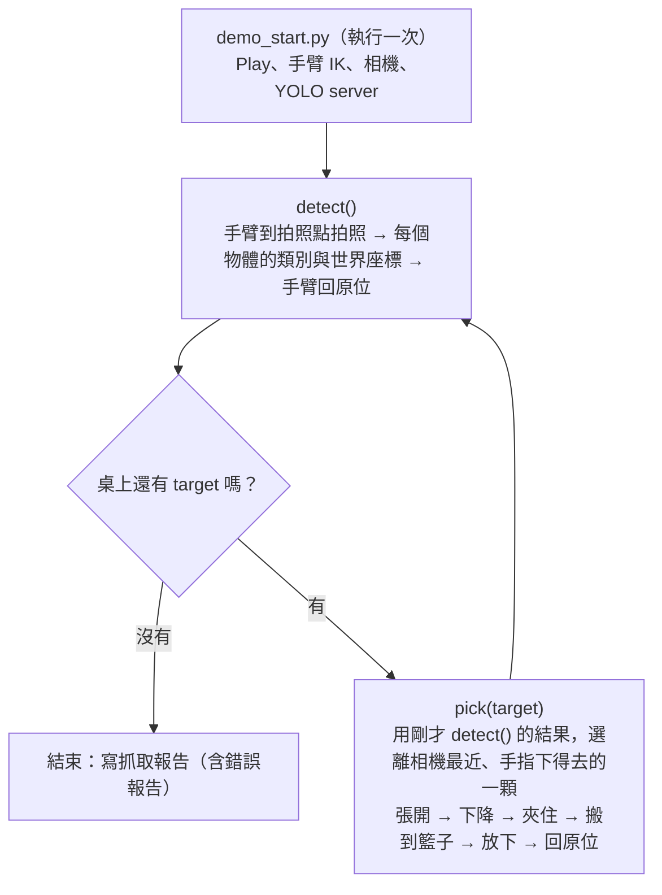

# nhc-d455-yolo-2

> English version: [README.md](README.md)

**目的**：在 Isaac Sim 裡，讓 NHC12 手臂（手腕裝 Robotiq 2F-85 夾爪和 D455 相機）自己找出桌上指定種類的積木，並依序夾進籃子。
- 積木有四種：`cube`、`cuboid`、`cylinder`、`sphere`。
- 相機拍照後，用 YOLO 判斷種類，用深度算出每個物體的世界座標。
- 離相機近的物體先夾，每夾一顆都重新拍照確認。
- 每次執行都會產生 HTML 報告：手腕照、正面照、錯誤報告。

## 使用方法

**第一次（只做一次）**：建立 YOLO 用的 Python 環境（不動 Isaac Sim 內建的 python）。

```bash
bash perception/setup_yolo_env.sh
```

**每次開 Isaac Sim 後**

1. Isaac Sim 開啟本資料夾的 `scenes/arm310d_d455_ik_demo.usd`（不用先按 Play，會自動 Play）。
2. Script Editor 開 `demo_start.py` → Ctrl+Enter。它會啟動手臂 IK、D455 相機和 YOLO server，約 10 秒。
3. 在 Script Editor 裡呼叫：

```python
detect_pick("sphere")      # 把桌上所有 sphere 依序夾進籃子，做完自動開報告
```

**可以呼叫的功能**（每個都獨立，可以任意順序）

| 呼叫 | 做什麼 | 報告 |
|---|---|---|
| `detect_pick("sphere")` | `detect()` → `pick()` 重複，直到桌上沒有 sphere。做完自動開報告 | `outputs/pick/<時間>/index.html` |
| `detect()` | 手臂到拍照點拍照（需要時多拍第二個視角）→ 類別、信心、世界座標 → 手臂回原位。結果留給 `pick()` 用 | `outputs/oneclick/<時間>/index.html` |
| `pick("sphere")` | 用**上一次 `detect()`** 的結果，把離相機最近的一顆 sphere 夾進籃子，然後回原位 | `outputs/pick/<時間>/index.html` |
| `pick("sphere", id=3)` | 同上，但指定 `detect()` 報告裡的 id | 同上 |
| `layout("sphere")` | （測試用）重新隨機擺 10 顆積木（含所有 sphere），籃子清空。積木只在記憶體中，不會存進場景檔 | — |
| `refresh()` | Isaac Sim 跑久了變慢時：重新開啟場景（不存檔）並重新啟動。測試積木會消失，需要時再 `layout()` | — |
| `status()` | 現在在做什麼（含目前步驟）、上一個結果 | — |

- **target**：`"cube"` / `"cuboid"` / `"cylinder"` / `"sphere"`。**order_by**：`"camera"`（預設，離相機最近的先夾）或 `"arm_base"`。
- 呼叫後會馬上回傳 `scheduled`，動作在背景跑（Isaac Sim 要持續更新畫面）。用 `status()` 看進度和結果。
- 同一時間只跑一個動作；忙碌中再呼叫會回傳 `busy`。
- `pick()` 只相信最新的 `detect()`。任何 `pick()` / `detect_pick()` / `layout()` 之後桌面已改變，要先再 `detect()`，否則會回傳 `refused` 並說明原因。
- 動作進行中 IK target（`/World/IKTarget`）會隱藏，結束後恢復顯示。
- 時間：`detect()` 約 10–25 秒；`detect_pick()` 約 1 分鐘/顆。
- **捷徑**：`grasp/one_click_pick.py`（改 `TARGET` → Ctrl+Enter）＝執行 `demo_start.py` ＋ `detect_pick(TARGET)`。

## 運作方式

**辨識（`detect()`）**
- 手臂到固定拍照點，D455 左眼拍 RGB 和深度，YOLO26n-seg 找出每個物體的輪廓與類別。
- 用深度算出每個物體的世界座標中心：可見的上表面，加上球、躺倒圓柱的擬合。
- 信心低於 0.7，或有 YOLO 沒解釋到的深度區域時，才會到第二個視角再拍一次。
- 精度：163 個物體的中心誤差最大 1.2 mm。

**夾取細節（`pick()`）**
- 夾取方向：手指垂直向下，從物體短邊夾；會撞到旁邊物體就換角度（±15°、±30°、90°；圓形每 15°），都不行就跳過。
- 抓取高度：物體中心；矮的物體再往下，讓指墊夾到實體。
- 夾取：(1) 先用辨識到的物體寬度，一次合到「指墊離物體各 3 mm」的角度（快）；(2) 再每次合 1°、等手指跟上；手指第一次跟不上（落後 ≥1°）＝碰到物體，這時力量還很小；(3) 之後只再多合 5°，一樣一步一步來，讓夾力固定而且小。不會用最大力合到底，所以指墊不會壓進球體或方塊。報告裡每次夾取都記錄指墊間距和物體寬度，可以直接看出夾得多深。
- 抓取高度也考慮指尖合起時會往下 8–13 mm，指墊不會先碰到桌面。
- 失敗時：沒夾到或途中掉了，就重拍再試；同一位置失敗 2 次就跳過，並寫進錯誤報告。
- 搬運：夾住後，離開桌面的前 12 cm 慢速抬起；之後移到籃子的速度和靠近物體時一樣。每段移動後都確認手指仍夾著。
- 放置：籃子上方拍深度圖，選離手臂最近的空格放下。


**任務沒完成時怎麼知道**：報告最上面的「錯誤報告」會自動列出，每一條都有「發生什麼 / 判斷原因 / 決定怎麼處理」：

| 類型 | 意思 | 程式怎麼處理 |
|---|---|---|
| 籃內數量少於預期 | 籃子裡的目標數 < 桌上應有的目標數 | 列出沒進籃子的每一顆與原因 |
| wrong_class | 夾到的不是指定類別 | 記錄，放進籃子後繼續 |
| missed_grasp | 夾爪合起來都沒碰到東西 | 重新拍照再試；同一位置失敗 2 次就跳過 |
| dropped | 抬起或搬運途中掉了 | 重新拍照再試；同上 |
| not_in_basket | 放開後不在籃子裡 | 記錄 |
| skipped（擋住） | 試過的所有夾取角度，手指都會撞到旁邊物體 | 跳過並報告 |

**卡住時**：`status()` 的 `error` 欄有原因（含 Python traceback）。進度檔 `outputs/pick/latest_status.json`、`outputs/oneclick/latest_status.json` 的 `step` 是停下的步驟（例如 `pick2:lift`）。

## 流程圖：`detect_pick(target)`



| 功能 | 需要 | 產生 |
|---|---|---|
| `demo_start.py` | Isaac Sim 開著本資料夾的場景 | 手臂、相機、YOLO 準備好 |
| `detect()` | `demo_start.py` 已執行 | 物體清單（id、類別、信心、世界座標）＋辨識報告 `outputs/oneclick/<時間>/` |
| `pick(target)` | 最新的 `detect()` 結果（桌面還沒被動過） | 一顆放進籃子＋抓取報告 `outputs/pick/<時間>/`（手腕照、正面照、錯誤報告） |
| `detect_pick(target)` | `demo_start.py` 已執行 | 上圖的迴圈，一份抓取報告 |


## 資料夾結構

| 位置 | 內容 |
|---|---|
| `demo_start.py` | **入口**：執行一次後呼叫 `detect()` / `pick()` / `detect_pick()` 等 |
| `grasp/pick.py` | 抓取流程（`detect()` / `pick()` / `detect_pick()` 的本體、報告） |
| `grasp/planner.py` | 夾取方向、張開寬度、抓取高度、籃內放置格（純計算） |
| `grasp/one_click_pick.py` | 捷徑：`demo_start.py` ＋ `detect_pick(TARGET)` |
| `perception/one_click.py` | 辨識流程（拍照點、YOLO、深度 → 世界座標、辨識報告） |
| `perception/geometry.py` | 深度 → 世界座標、形狀擬合 |
| `perception/yolo_server.py` | YOLO 推論（獨立 Python 環境，由 `detect()` 自動啟動） |
| `perception/config.json` | 拍照點、工作區、桌面高度、模型與 YOLO 環境路徑 |
| `perception/place_test_blocks.py` | 測試積木（`layout()` 使用） |
| `perception/setup_yolo_env.sh`、`requirements.lock.txt` | 建立 YOLO 環境 |
| `scripts/` | 手臂與相機的底層：`ik_controller.py`、`gripper_controller.py`、`pose_math.py`、`d455_capture.py`、`prim_cache.py` |
| `models/best.pt` | 已訓練的 YOLO26n-seg |
| `scenes/`、`assets/` | 場景與機器人、桌子資產（場景用相對路徑引用 assets）。**不要存檔覆寫場景** |
| `outputs/` | 報告與進度檔（只有兩份範例報告進 git） |

舊版 demo 的程式（舊 `scripts/demo_start.py` 等）已移除，保存在 git tag `archive/old-scripts`。

## 已驗證範圍與未來風險

**已驗證**（2026-09-30，最終版本）：每種 target 都用 `layout()` 重新隨機擺 10 顆積木，再跑 `detect_pick()`。

| target | 結果 | 時間 | 指墊夾入深度（每邊） |
|---|---|---|---|
| sphere | 3/3 | 151 秒 | 1.2–1.3 mm |
| cuboid | 3/3 | 147 秒 | ≤1.4 mm |
| cube | 4/4 | 194 秒 | 0.4–1.0 mm |
| cylinder（含躺倒） | 4/4 | 189 秒 | ≤1.6 mm |

- 全部 14/14，0 錯誤，平均約 49 秒/顆。
- 夾入深度以真實寬度計算。報告裡若看到較大的值，是辨識把寬度量大了（斜夾、躺倒圓柱），不是夾得深。
- timeline 已按 Stop 時呼叫也能正常啟動；長時間執行後仍約 41 FPS。
- 辨識精度：163 個物體全部找到，類別全對，中心誤差最大 1.2 mm。

| # | 風險 | 現況 / 可能的對應 |
|---|---|---|
| 1 | 擺放太密，手指下不去 | 已試 0/±15/±30/90°（圓形每 15°），再不行就跳過並報告。對應：先移開旁邊的物體，或用推的 |
| 2 | 躺倒圓柱、球會滾 | 每輪重新辨識所以會追上；滾到籃子或手臂搆不到的地方會漏抓 |
| 3 | 物體寬度量大（躺倒圓柱、斜著的方塊，大 5–15 mm） | 只會讓快速靠近停得早一點（多約 30 格），不影響夾取。對應：用擬合的直徑或邊長代替外框 |
| 4 | 模型訓練範圍 | 相機高 0.43–0.56 m、傾角 9–27°、物體 40–80 mm；換物體大小、顏色、光線、桌面要重驗或重訓 |
| 5 | 物體 > 60–70 mm、很重、很滑 | 夾爪最大開口 85 mm；夾力＝碰到後再合 5°（小而固定）；摩擦 1.0；積木 0.05 kg。更重或更滑的物體可能要加大 `SQUEEZE_DEG`，或讓搬運變慢（`grasp/pick.py`） |
| 6 | 籃子滿了 | 用深度選空格；滿了會疊在上面或掉出，目前只能由「不在籃內」事後發現 |
| 7 | IK 搆不到 | 桌面遠端、籃子深角落沒有系統測試 |
| 8 | 模擬器顯示和物理不同步 | 測試積木放在 session layer，編輯目標必須是 session layer；改場景流程時要保留 |
| 9 | 拍照卡住（已處理） | Isaac Sim 6.0 Replicator `step_async()` 會關掉 timeline auto-update 後無限等待，手臂與物理就凍結。看門狗 5 秒後恢復，每次多花 5 秒。場景檔的 timeline 只有 1 格（−1→0），可能是原因之一 |
| 10 | 越跑越慢（已處理） | 原因是每次呼叫都新建 `Articulation`／`XformPrim`，會留下 physics view。現在共用同一個物件（`scripts/prim_cache.py`）；新程式要取得 prim 時也要用 `cached_prim()`。仍變慢時用 `refresh()` |
| 11 | 真機移植 | 真值只用於報告；夾到與否用手指角度判斷，真機需校正夾爪角度與力量 |
