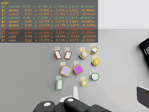
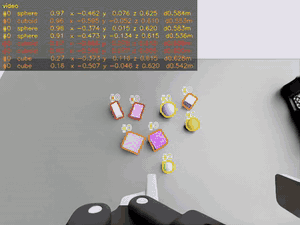
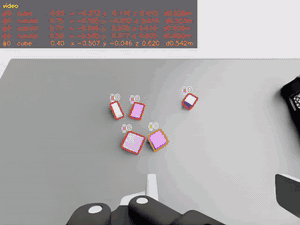
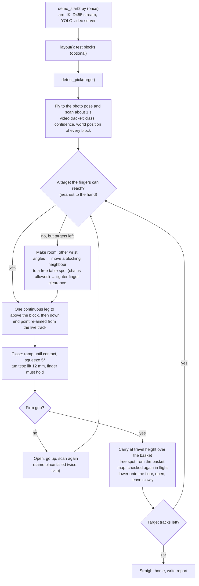

# arm-detect-and-pick

> 中文版：[README-zh.md](README-zh.md)

## Goal

In Isaac Sim, an NHC12 arm (Robotiq 2F-85 gripper and a D455 camera on the wrist) finds the blocks of one chosen type on a table and puts them into a basket, one after the other, **without stopping between steps**.

- There are four block types: `cube`, `cuboid`, `cylinder`, `sphere` (20–60 mm).
- Everything the arm sees comes from the wrist D455 stream: YOLO class and mask and the depth are computed continuously, and the world position of every block is kept up to date while the arm moves.
- The arm flies one continuous path per leg. It stops only to grasp and to release.
- The basket is read with the same depth video: a block is put down only on free floor, never on a block that is already there.
- If every target is blocked by a neighbour, the arm moves the neighbour aside first.

<p align="center"></p>

### Demo

The three clips are the wrist camera as it was recorded (class, confidence and world position of each block in the top-left corner). Each run was one call, e.g. `detect_pick("sphere")`.

<table>
  <tr>
    <th align="center">cylinder</th>
    <th align="center">sphere</th>
    <th align="center">cube</th>
  </tr>
  <tr>
    <td align="center"><br><a href="media/demo_cylinder.mp4">mp4</a></td>
    <td align="center"><br><a href="media/demo_sphere.mp4">mp4</a></td>
    <td align="center"><br><a href="media/demo_cube.mp4">mp4</a></td>
  </tr>
  <tr>
    <td valign="top">
      <table>
        <tr><th>pick</th><th>conf</th><th>arrive to release (s)</th></tr>
        <tr><td>1</td><td>0.97</td><td>3.15</td></tr>
        <tr><td>2</td><td>0.96</td><td>4.03</td></tr>
      </table>
    </td>
    <td valign="top">
      <table>
        <tr><th>pick</th><th>conf</th><th>arrive to release (s)</th></tr>
        <tr><td>1</td><td>0.85</td><td>3.40</td></tr>
        <tr><td>2</td><td>0.90</td><td>3.17</td></tr>
        <tr><td>3</td><td>0.86</td><td>3.80</td></tr>
      </table>
    </td>
    <td valign="top">
      <table>
        <tr><th>pick</th><th>conf</th><th>arrive to release (s)</th></tr>
        <tr><td>1</td><td>0.51</td><td>3.67</td></tr>
        <tr><td>2</td><td>0.93</td><td>3.38</td></tr>
      </table>
    </td>
  </tr>
</table>

*conf* = YOLO confidence when the block was chosen. *arrive to release* = from the moment the hand is at the block to the moment the block is released in the basket (simulation seconds).

## Equipment

| Part | What |
|---|---|
| Simulator | NVIDIA Isaac Sim 6.0.0 (scene `scenes/arm310d_d455_ik_demo.usd`) |
| Arm | Yaskawa Motoman NEXT NHC12, driven by differential IK on a target prim (`/World/IKTarget`) |
| Gripper | Robotiq 2F-85 (max opening 85 mm, fingers 31 × 27 mm) |
| Camera | Intel RealSense D455 on the wrist: RGB + depth, 640 × 480, path-traced |
| Perception | YOLO26n-seg (`models/best.pt`, four classes), run in its own Python environment (`perception/.venv`); depth → world points |
| Scene | Packing table, basket `container_h20` (floor is a lattice), test blocks with physics (friction 1.0, damping on balls and cylinders) |

YOLO was trained on 328 simulated images (20 blocks, 5 per class; camera 0.43–0.56 m above the table, 9–27° from vertical; 100 epochs; mask mAP50 0.885). Details: `models/train_args.yaml`, `models/train_results.csv`.

## Output storage

All generated reports, videos, images and logs are written under `outputs/`, a symbolic link to `/mnt/data/Lin(sda)/nhc-d455-yolo-2(result only)`. Keep `/mnt/data` mounted before running. Git tracks the link, not the files. The demo clips and the overview picture are stored in `media/`.

## Usage

**Once**: build the Python environment for YOLO (Isaac Sim's own Python is not touched).

```bash
bash perception/setup_yolo_env.sh
```

**Every time after starting Isaac Sim**

1. Open `scenes/arm310d_d455_ik_demo.usd` from this folder (no need to press Play).
2. Open `demo_start2.py` in the Script Editor and press Ctrl+Enter **once**. It only gets the arm ready (about 10 s) and prints `demo_start2: READY`. Nothing moves.
3. Call a function in the Script Editor:

```python
layout("sphere")          # (testing) 10 new random blocks, all sizes of that type included; basket emptied
detect_pick("sphere")     # pick every sphere into the basket
```

**Functions**

| Call | What it does | Result |
|---|---|---|
| `detect_pick(target)` | `target` = `"cube"` (default) / `"cuboid"` / `"cylinder"` / `"sphere"`. Looks at the table for about 1 s, then picks the blocks of that type one by one into the basket. `max_picks` (default 12) limits the number of picks | `outputs/lab/live/run_<time>/index.html` |
| `layout()` | (Testing) 10 new random blocks of any type, with physics; basket emptied; the red `object` cube of the original scene is removed for the session (never saved) | prints how many of each type |
| `layout("sphere")` | Same, but every size of that type (sphere 40/50/60 mm) is on the table, so `detect_pick("sphere")` has something to pick | — |

- Both calls return at once and run in the background; the console prints `started` and `done` (with a short result). Only one action runs at a time; a call while busy prints `[busy]`.
- You can call `detect_pick()` for several types in a row on the same layout. The basket content is remembered between calls; `layout()` resets it.
- While an action runs the IK target marker is hidden (it would block the camera).
- The Script Editor does not reload a file changed on disk. `lab/*.py` is read from disk on every `detect_pick()`, but `layout()` lives in `lab/api2.py`, which is loaded by `demo_start2.py`: after changing `api2.py`, press Ctrl+Enter on `demo_start2.py` again.
- Time: about 5–6 s per block, plus about 1.5 s for the scan and the way home.

**What a run writes** (`outputs/lab/live/run_<time>/`)

| File | Content |
|---|---|
| `index.html` | Video, one row per pick (class, confidence, seconds), which blocks moved |
| `wrist.mp4` | Annotated wrist video; top-left list `#id class conf x y z d` updated every frame |
| `result.json` | Every number: events with sim-seconds, grasp data, tug test, basket spots, tracks vs. stage values |
| `frames/` | Single annotated frames |

(The older two-photo flow with `detect()` / `pick()` is still in the repository: `demo_start.py`, `grasp/`. It is not changed.)

## Flow of `detect_pick(target)`



| Step | Needs | Produces |
|---|---|---|
| `demo_start2.py` | Isaac Sim with this folder's scene open | Arm IK ready |
| `layout()` | `demo_start2.py` has run | New test blocks, empty basket, basket memory reset |
| `detect_pick(target)` | `demo_start2.py` has run | Blocks in the basket, report `outputs/lab/live/run_<time>/` |

## How it works

### Perception

The D455 depth image is turned into world coordinates frame by frame: every pixel becomes a point in the world using the camera pose of that very frame, the points standing above the table are the blocks, and the visible top of each block gives its centre and size. Recognition keeps running in the background and the arm never waits for it: it plans from the positions seen while it was still, and only nudges the end of its path with the live position as it comes down.

### Picking

The arm goes for the reachable target nearest to its hand and closes the fingers across the short side, turning the wrist if a neighbour is in the way; if every target is blocked, it first moves a blocking neighbour aside. After closing it lifts the block a few millimetres and checks the grip: if the fingers hold, it carries on; if not, it lets go and looks again.

### Placing

**Spot.** Once the block is in the gripper, the arm takes the free place in the basket nearest to itself, one where both the block and the open fingers fit without touching anything.

**Check in flight.** While carrying the block over the basket the arm looks at the basket once more; if something has come into the way, it bends the end of its path to the nearest free place without stopping, and only then lowers the block and lets go.

## Folder layout

| Path | Content |
|---|---|
| `demo_start2.py` | **Entry point**: Ctrl+Enter once, then call `layout()` / `detect_pick()`. A short loader for `lab/api2.py` |
| `lab/api2.py` | `layout()` and `detect_pick()` |
| `lab/live_pick.py` | The pick loop (scan, choose, make room, fly, close, check, place), the HTML report |
| `lab/live_perception.py` | Perception: D455 stream, YOLO + depth, tracker, basket map |
| `lab/fast_pick.py` | Continuous trajectory, gripper close / release, all parameters (`P`) |
| `lab/yolo_live.py` | Low-latency YOLO server (port 18778, started automatically) |
| `lab/README-lab.md` | Notes of the lab version |
| `lab/seq_eval.py`, `class_eval.py`, `phys_test.py`, … | Test harnesses (not needed for normal use) |
| `grasp/planner.py` | Grasp angle, opening width, grasp height (pure computation, shared with the old flow) |
| `perception/` | `geometry.py` (depth → world points, shape fitting), `yolo_server.py`, `config.json` (photo pose, workspace, table height), `setup_yolo_env.sh` |
| `scripts/` | Low-level arm and camera code (IK, gripper, pose math, D455 capture) |
| `models/best.pt` | Trained YOLO26n-seg with its training files |
| `scenes/`, `assets/` | Scene, robot and table assets. **Do not save over the scene** (test blocks live in the session layer) |
| `media/` | The overview picture and demo clips shown above |
| `outputs/` | Symbolic link to the result disk; all generated files, outside Git |

## Known limits

| # | Limit | Status / possible answer |
|---|---|---|
| 1 | Blocks so close that no finger pose fits | Wrist angles, moving a neighbour aside and tighter clearance solve most clusters; a ring of blocks that block each other needed the 2 mm tier. The 2 mm and 3 mm tiers are only checked in simulation |
| 2 | Spheres and lying cylinders roll | Damping is set in the test scene; a block that rolls out of reach is only found by the next scan |
| 3 | A grasp can slip | Tug test and re-scan; two failures at the same place → skipped |
| 4 | Basket memory | Placements are remembered and the map is refreshed whenever the camera sees the basket; blocks moved by hand without a view of them are noticed only when the hand passes over them |
| 5 | Model range | Trained for 20–60 mm blocks, camera 0.43–0.56 m high; other sizes, colours, lighting or tables need a re-check or retraining |
| 6 | Heavy or slippery objects | Opening ≤ 85 mm (width ≤ 70 mm used); grip force = 5° after touch |
| 7 | Not yet run by a person | Tested through the MCP with `demo_start2.py` loaded; not yet run by pressing Ctrl+Enter in the Script Editor |
| 8 | Real robot | Stage values are used only in reports. Grasp success is judged from the finger angle; a real robot needs gripper calibration |
