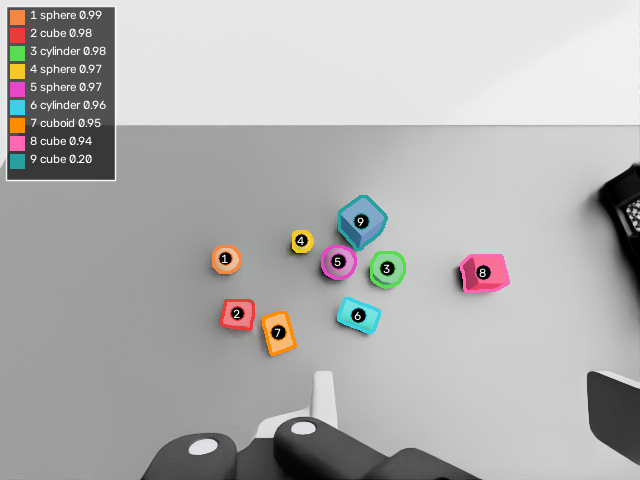
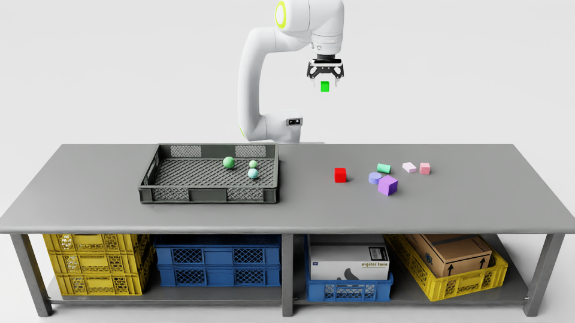
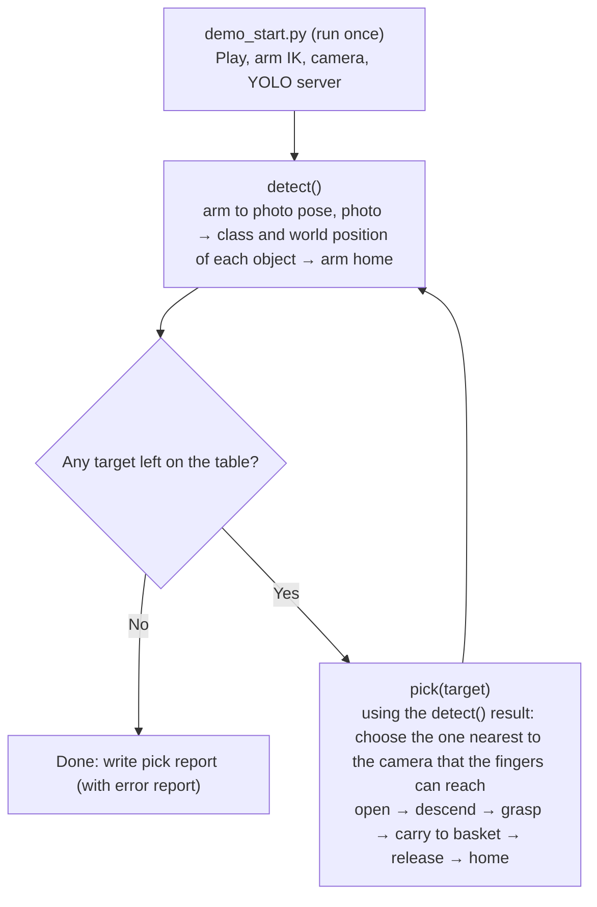

# arm-detect-and-pick

> 中文版：[README-zh.md](README-zh.md)

**Goal**: In Isaac Sim, an NHC12 arm (Robotiq 2F-85 gripper and a D455 camera on the wrist) finds blocks of a chosen type on a table and puts them into a basket one by one.
- There are four block types: `cube`, `cuboid`, `cylinder`, `sphere`.
- After taking a picture, YOLO gives the type. Depth gives the world position of each object.
- The object nearest to the camera is picked first. The scene is re-photographed after every pick.
- Every run writes an HTML report: wrist photos, front photos, and an error report.

## Usage

**Once**: build the Python environment for YOLO (Isaac Sim's own Python is not touched).

```bash
bash perception/setup_yolo_env.sh
```

**Every time after starting Isaac Sim**

1. Open `scenes/arm310d_d455_ik_demo.usd` from this folder in Isaac Sim (no need to press Play; it plays automatically).
2. Open `demo_start.py` in the Script Editor and press Ctrl+Enter. It starts arm IK, the D455 camera and the YOLO server (about 10 s).
3. Call from the Script Editor:

```python
detect_pick("sphere")      # pick all spheres on the table into the basket, then open the report
```

**Functions** (each is independent, any order)

| Call | What it does | Report |
|---|---|---|
| `detect_pick("sphere")` | Repeats `detect()` → `pick()` until no sphere is left. Opens the report when done | `outputs/pick/<time>/index.html` |
| `detect()` | Arm goes to the photo pose and takes a picture (a second view if needed) → class, confidence, world position → arm returns home. The result is kept for `pick()` | `outputs/oneclick/<time>/index.html` |
| `pick("sphere")` | Uses the **last `detect()`** result. Puts the sphere nearest to the camera into the basket, then returns home | `outputs/pick/<time>/index.html` |
| `pick("sphere", id=3)` | Same, but for a given id from the `detect()` report | same |
| `layout("sphere")` | (Testing) Re-places 10 random blocks (including spheres) and empties the basket. Blocks live only in memory and are never saved to the scene file | — |
| `refresh()` | When Isaac Sim gets slow: reopens the scene (no save) and restarts. Test blocks disappear; call `layout()` again if needed | — |
| `status()` | What is running now (with the current step) and the last result | — |

- **target**: `"cube"` / `"cuboid"` / `"cylinder"` / `"sphere"`. **order_by**: `"camera"` (default, nearest to the camera first) or `"arm_base"`.
- A call returns `scheduled` at once and the action runs in the background (Isaac Sim must keep updating the screen). Use `status()` to see progress and results.
- Only one action runs at a time. A call while busy returns `busy`.
- `pick()` trusts only the latest `detect()`. After any `pick()` / `detect_pick()` / `layout()` the table has changed, so call `detect()` again. Otherwise the call returns `refused` with the reason.
- While an action runs, the IK target (`/World/IKTarget`) is hidden and shown again at the end.
- Time: `detect()` takes 10–25 s; `detect_pick()` about 1 minute per object.
- **Shortcut**: `grasp/one_click_pick.py` (edit `TARGET`, Ctrl+Enter) = run `demo_start.py` + `detect_pick(TARGET)`.

## `detect()`: what it does and what to expect

Example run: [`outputs/oneclick/20260930_181331/index.html`](outputs/oneclick/20260930_181331/index.html)
(GitHub shows HTML as source. To view it as a page, download the repo or use the
[preview link](https://htmlpreview.github.io/?https://github.com/hayashimatsu/arm-detect-and-pick/blob/main/outputs/oneclick/20260930_181331/index.html).)



*View A (D455 left camera). Each object has an id, a class, and a YOLO confidence. The colored outline is the YOLO mask.*

### Steps

1. **Move.** The arm goes to a fixed photo pose (view A: camera about 0.55 m from the table, 25° from vertical).
2. **Capture.** The D455 left camera takes an RGB image and a depth image.
3. **YOLO.** `models/best.pt` (YOLO26n-seg) returns a class, a confidence and a pixel mask for each object. Candidates down to confidence 0.05 are kept for the next steps. YOLO26 has no NMS, so one object can get two boxes; `yolo_server.py` removes the duplicate when two masks overlap by IoU > 0.7 (the higher confidence stays).
4. **Depth → world.** Every depth pixel is converted to a world point. Only points 8–150 mm above the table inside the workspace count as objects.
5. **Filter.** Detections with confidence ≥ 0.25 are kept. A low-score candidate is also kept if ≥ 60% of its mask is a real bump above the table and it does not overlap an accepted object. A bump that no mask explains becomes an `unknown` object (position from depth only).
6. **Position.** For each mask the visible top surface gives the world center. A sphere and a lying cylinder are fitted with their true shape. The result also has a height.
7. **Cube vs cuboid.** These two are the hardest pair for one RGB image, so the class is decided by the depth-measured edge ratio (longest / shortest edge < 1.15 → `cube`), not by YOLO.
8. **Second view (only if needed).** If any object has confidence < 0.7, or some depth is unexplained, the arm also goes to view B (about 0.38 m, 25°) and repeats steps 2–7. Objects are matched between views by world XY (≤ 30 mm). View B's class is used only if view A's confidence is < 0.7. The center always comes from view A.
9. **Return and report.** The arm goes back home. The HTML and `result.json` are written.

### How YOLO was trained

| Item | Value |
|---|---|
| Model | YOLO26n-seg (instance segmentation), starting from the pretrained `yolo26n-seg.pt` |
| Classes | `cube`, `cuboid`, `cylinder`, `sphere` (`models/data.yaml`) |
| Data | 328 images of the simulated table (31 original + 3 batches of about 99), showing 20 registered blocks: 5 cube, 5 cuboid, 5 cylinder, 5 sphere |
| Camera in the data | About 7 fixed poses: 0.43–0.56 m above the table, looking down, 9–27° from vertical |
| Training | 100 epochs, AdamW, batch 4, image size 640 (`models/train_args.yaml`) |
| Augmentation | Small color shift (hsv 0.015 / 0.4 / 0.2), translate 0.1, scale 0.2, horizontal flip 0.5. No rotation, no mosaic |
| Final validation (epoch 100) | Mask: precision 0.83, recall 0.85, mAP50 0.885, mAP50-95 0.820 (`models/train_results.csv`, curves and `models/confusion_matrix.png`) |

### What we expect, and what this run shows

- **Expected**: for blocks 20–60 mm on this table, seen from view A (inside the training camera range), YOLO gives the right class with high confidence and a mask that follows the outline. Cube and cuboid can be mixed up (the same face can look square), so the depth edge ratio decides between them. Views far from the training range (closer, more tilted) are worse, not better.
- **Accuracy over 163 test objects** (14 random layouts): all objects found, all classes correct, center error at most 1.2 mm.
- **This run** (9 objects, 14.6 s in total):

| id | class | conf | center X, Y, Z (m) | height (mm) |
|---|---|---|---|---|
| 1 | sphere | 0.99 | −0.7005, 0.0264, 0.6200 | 49.6 |
| 2 | cube | 0.98 | −0.6687, −0.0708, 0.6152 | 40.0 |
| 3 | cylinder | 0.98 | −0.4150, 0.0109, 0.6102 | 30.0 |
| 4 | sphere | 0.97 | −0.5680, 0.0640, 0.6151 | 39.8 |
| 5 | sphere | 0.97 | −0.5019, 0.0195, 0.6250 | 59.5 |
| 6 | cylinder | 0.96 | −0.4704, −0.0714, 0.6149 | 39.3 |
| 7 | cuboid | 0.95 | −0.6017, −0.0982, 0.6052 | 20.0 |
| 8 | cube | 0.94 | −0.2500, −0.0003, 0.6202 | 50.1 |
| 9 | cube | 0.20 | −0.4585, 0.0978, 0.6252 | 60.1 |

  - All 9 objects have the right class. Centers match the stage values within 0.6 mm (see the error rows in the HTML).
  - #9 got confidence 0.20 in view A, so the arm visited view B (confidence 0.56 there). The class `cube` was confirmed by the depth edge ratio, not by YOLO.
  - Stage values in the HTML are for comparison only. The robot never uses them.

More files in the run folder: `result.json` (all numbers, per view), `view_A/`, `view_B/` (RGB, depth, masks, camera pose), `gt_eval_only.json` (stage values, for checking only).

## `detect_pick()`: before and after

Example run: [`outputs/pick/20260930_181324/index.html`](outputs/pick/20260930_181324/index.html)
([preview link](https://htmlpreview.github.io/?https://github.com/hayashimatsu/arm-detect-and-pick/blob/main/outputs/pick/20260930_181324/index.html)).
The call was `detect_pick("sphere")`. It repeated `detect()` → `pick()` until no sphere was left.
**Result: 3 / 3 spheres in the basket, no errors, 195 s.**

| Before (front camera) | After (front camera) |
|---|---|
|  |  |

The full report also has the wrist photo of each pick over the basket, the grasp data (gripper yaw, finger stop angle), and the link to the `detect()` report used for each pick.

## How it works

**Picking (`pick()`)**
- Grasp direction: fingers point straight down and close on the short side. If a finger would hit a neighbor, the yaw is changed (±15°, ±30°, 90°; every 15° for round objects). If nothing works, the object is skipped.
- Grasp height: object center; lower for short objects so the pads touch solid material. It also allows for the fingertips moving down 8–13 mm when they close, so the pads do not hit the table first.
- Closing: (1) close at once to the angle where each pad is 3 mm from the object, using the detected width (fast); (2) then 1° at a time, waiting for the fingers to follow. The first time a finger lags by ≥ 1°, it has touched the object, and the force is still small; (3) then close only 5° more, again step by step, so the force is small and constant. It never closes with full force, so the pads do not press into a sphere or box. The report records pad gap and object width for each grasp, so the grip depth can be read directly.
- On failure (nothing grasped, or dropped on the way): re-photograph and retry. Two failures at the same place → skip and write it in the error report.
- Carrying: after grasping, the first 12 cm above the table is lifted slowly; after that the arm moves at the same speed as when approaching. Finger closure is checked after each move.
- Placing: a depth image of the basket is taken from above, and the empty cell nearest to the arm is chosen.

**Knowing when a task did not finish**: the error report at the top of the report lists each problem with "what happened / likely cause / what was decided".

| Type | Meaning | What the program does |
|---|---|---|
| Fewer in basket than expected | Targets in the basket < targets on the table | Lists each missing object with its reason |
| wrong_class | The object picked is not the requested class | Records it, puts it in the basket, continues |
| missed_grasp | The gripper closed on nothing | Re-photograph and retry; 2 failures at the same place → skip |
| dropped | Dropped during lift or carry | Re-photograph and retry; same as above |
| not_in_basket | Not in the basket after release | Records it |
| skipped (blocked) | At every tried angle the fingers would hit a neighbor | Skips it and reports |

**When stuck**: the `error` field of `status()` has the reason (with the Python traceback). In the progress files `outputs/pick/latest_status.json` and `outputs/oneclick/latest_status.json`, `step` is where it stopped (for example `pick2:lift`).

## Flowchart: `detect_pick(target)`



| Function | Needs | Produces |
|---|---|---|
| `demo_start.py` | Isaac Sim with this folder's scene open | Arm, camera and YOLO ready |
| `detect()` | `demo_start.py` has run | Object list (id, class, confidence, world position) + report `outputs/oneclick/<time>/` |
| `pick(target)` | Latest `detect()` result (table not touched since) | One object in the basket + pick report `outputs/pick/<time>/` (wrist photos, front photos, error report) |
| `detect_pick(target)` | `demo_start.py` has run | The loop above, one pick report |

## Folder layout

| Path | Content |
|---|---|
| `demo_start.py` | **Entry point**: run once, then call `detect()` / `pick()` / `detect_pick()` etc. |
| `grasp/pick.py` | Pick flow (the body of `detect()` / `pick()` / `detect_pick()`, reports) |
| `grasp/planner.py` | Grasp direction, opening width, grasp height, basket cells (pure computation) |
| `grasp/one_click_pick.py` | Shortcut: `demo_start.py` + `detect_pick(TARGET)` |
| `perception/one_click.py` | Perception flow (photo poses, YOLO, depth → world position, report) |
| `perception/geometry.py` | Depth → world points, shape fitting |
| `perception/yolo_server.py` | YOLO inference (separate Python environment, started by `detect()`) |
| `perception/config.json` | Photo poses, workspace, table height, model and YOLO environment paths |
| `perception/place_test_blocks.py` | Test blocks (used by `layout()`) |
| `perception/setup_yolo_env.sh`, `requirements.lock.txt` | Build the YOLO environment |
| `scripts/` | Low level arm and camera code: `ik_controller.py`, `gripper_controller.py`, `pose_math.py`, `d455_capture.py`, `prim_cache.py` |
| `models/best.pt` | Trained YOLO26n-seg, with training args, results and confusion matrix |
| `scenes/`, `assets/` | Scene, robot and table assets (the scene refers to assets by relative path). **Do not save over the scene** |
| `outputs/` | Only the two example reports above are in git. Other runs are ignored |

## Verified range and future risks

**Verified** (2026-09-30, final version): for each target, `layout()` placed 10 random blocks, then `detect_pick()` ran.

| target | result | time | pad depth into object (per side) |
|---|---|---|---|
| sphere | 3/3 | 151 s | 1.2–1.3 mm |
| cuboid | 3/3 | 147 s | ≤ 1.4 mm |
| cube | 4/4 | 194 s | 0.4–1.0 mm |
| cylinder (incl. lying) | 4/4 | 189 s | ≤ 1.6 mm |

- Total 14/14, 0 errors, about 49 s per object.
- Pad depth is computed from the real width. A larger value in a report means the perceived width was too large (tilted grasp, lying cylinder), not a deep grip.
- Works when the timeline is stopped at start. About 41 FPS after a long run.
- Perception: 163 objects all found, all classes correct, center error at most 1.2 mm.

| # | Risk | Status / possible answer |
|---|---|---|
| 1 | Objects too close, fingers cannot go down | Tried 0/±15/±30/90° (every 15° for round). Then skip and report. Answer: move the neighbor first, or push |
| 2 | Lying cylinders and spheres roll | Re-detected every cycle so they are followed. One that rolls into the basket or out of reach is missed |
| 3 | Width too large (lying cylinder, tilted cube, by 5–15 mm) | The fast approach stops slightly early (about 30 steps more). Grasp is not affected. Answer: use the fitted diameter or edge instead of the outer box |
| 4 | Training range of the model | Camera 0.43–0.56 m high, 9–27° tilt, objects 40–80 mm. Other sizes, colors, lighting or tables need re-check or retraining |
| 5 | Object > 60–70 mm, heavy, or slippery | Max gripper opening 85 mm. Force = 5° closing after touch (small, constant). Friction 1.0, block 0.05 kg. Heavier or slipperier objects may need a larger `SQUEEZE_DEG` or slower carrying (`grasp/pick.py`) |
| 6 | Basket full | Empty cell chosen by depth. When full, objects stack or fall out; only found afterwards by "not_in_basket" |
| 7 | IK cannot reach | Far side of the table and deep basket corners are not systematically tested |
| 8 | Simulator display and physics out of sync | Test blocks are in the session layer; the edit target must be the session layer. Keep this when changing the scene flow |
| 9 | Capture freeze (handled) | In Isaac Sim 6.0, Replicator `step_async()` turns off timeline auto-update and waits forever, so arm and physics freeze. A watchdog restores it after 5 s (5 s extra per capture). The scene's timeline has only 1 frame (−1→0), which may be one cause |
| 10 | Getting slower over time (handled) | Every call used to create a new `Articulation` / `XformPrim`, leaving physics views behind. Now one shared object is used (`scripts/prim_cache.py`); new code must use `cached_prim()` too. If still slow, use `refresh()` |
| 11 | Move to a real robot | Ground truth is used only in reports. Grasp success is judged by finger angle; a real robot needs calibration of gripper angle and force |
